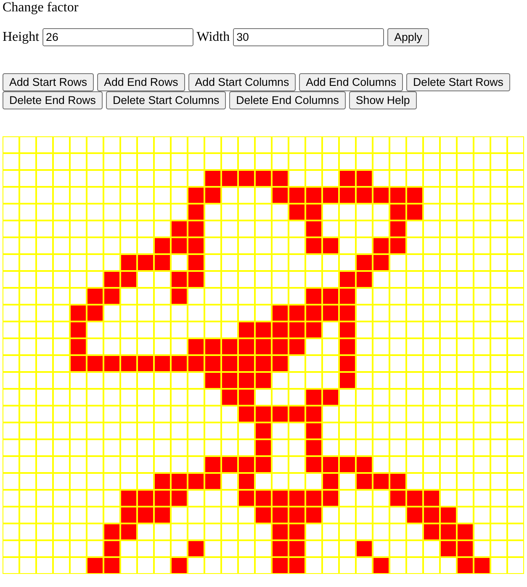

# Sketch-A-Etch

A sketching game I built for The Odin Project's Foundations course.

It has an index page built with resize buttons, change resize factor with input form, and the board itself. Internally it uses lots of events and is built quite modularly. 

View the live site: [sketch-a-etch.its-namami.dev](https://sketch-a-etch.its-namami.dev)

